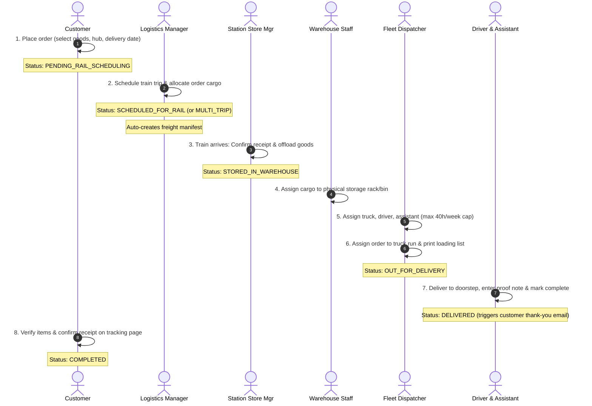

<div align="center">

# 🚂 KANDYPACK LOGISTICS PLATFORM 🚂

### Multimodal Rail & Road Supply Chain Distribution System
*From Kandy Central Depot to the Coast — One Seamless Journey, Tracked in Real Time.*

[](https://nextjs.org/)
[](https://www.typescriptlang.org/)
[](https://tailwindcss.com/)
[](https://fastapi.tiangolo.com/)
[](https://www.mysql.com/)

**[Live Web App (Vercel)](https://front-end-2-0-psi.vercel.app) · [Backend API (Render)](https://backend-bzhp.onrender.com) · [Design System](./DESIGN.md)**

</div>

---

## 📑 Table of Contents
1. [Platform Overview & Core Concept](#-platform-overview--core-concept)
2. [End-to-End Supply Chain Flow](#-end-to-end-supply-chain-flow)
3. [User Roles & Responsibilities](#-user-roles--responsibilities)
4. [Test Accounts, Emails & Passwords](#-test-accounts-emails--passwords)
5. [Step-by-Step End-to-End Testing Walkthrough](#-step-by-step-end-to-end-testing-walkthrough)
6. [Frontend Route Matrix](#-frontend-route-matrix)
7. [Local Setup & Running the Frontend](#-local-setup--running-the-frontend)
8. [Design System & UI Patterns](#-design-system--ui-patterns)
9. [Team — Group 20](#-team--group-20)

---

## 🌿 Platform Overview & Core Concept

**KandyPack** replaces manual, disjointed spreadsheets with a unified, database-driven logistics distribution platform shipping FMCG products from the central manufacturing hub in **Kandy** to six regional destination hubs:
* **Colombo (Goods Shed / Colombo Fort)**
* **Negombo**
* **Galle**
* **Matara**
* **Jaffna**
* **Trincomalee**

### Key Capabilities
- **Bulk Rail Haulage:** Uses Sri Lanka Railways freight wagons for long-distance transport between Kandy and regional depots.
- **Dynamic Spillover:** Large orders exceeding wagon weight or space capacity are partitioned across adjacent train trips.
- **Station Store Depots & Warehouse Bins:** Station managers confirm train arrivals and warehouse staff assign stock to physical racks/bins.
- **Last-Mile Truck Rostering:** Fleet dispatchers create daily truck delivery runs enforcing strict 40-hour weekly driver caps.
- **Real-Time Live Milestone Tracking:** Customers follow consignments across an 8-stage interactive visual timeline.

---

## 🔄 End-to-End Supply Chain Flow



---

## 👥 User Roles & Responsibilities

| Role Badge | Primary Interface | What This Role Does |
|---|---|---|
| **`CUSTOMER`** | `/orders`, `/order/new`, `/orders/[id]/track` | Places freight orders, tracks real-time progress across 8 milestone stages, and signs off delivery receipt. |
| **`LOGISTICS_MGR`** | `/admin/rail` | Plans train schedules from Kandy, checks wagon capacity, and allocates pending consignments to scheduled rail trips. |
| **`STORE_MGR`** | `/warehouse` | Receives incoming rail manifests at the destination station, confirms freight arrival, and manages depot stock. |
| **`WAREHOUSE_STAFF`** | `/warehouse` | Inspects station store stock, assigns packages to physical warehouse storage bins/racks, and manages stock adjustments. |
| **`DISPATCHER`** | `/admin/roster` | Plans local road delivery runs, matches available trucks and drivers within legal 40h/week driving caps, and generates truck manifests. |
| **`DRIVER`** & **`ASSISTANT`** | `/driver` | Views assigned vehicle and today's delivery run stops, records delivery proof notes, and marks doorstep handovers as complete. |
| **`SUPERADMIN`** | `/admin/users`, `/admin/reports` | Provisions internal staff accounts, enforces initial password resets, and views executive revenue and fleet utilization analytics. |

---

## 🔑 Test Accounts, Emails & Passwords

> **Universal Password:** All pre-seeded accounts use the same master password:
> ### `password123`
> * **Direct Password Sign-in:** Verified customers and staff accounts log in directly with their password without requiring any OTP!
> * **One-Time Registration Verification:** Newly registered customers only verify an OTP once upon registration to confirm email ownership.
> * **Password Recovery:** If you forget your password, click **"Forgot password?"** on `/login` to receive a 6-digit reset code via live email.
> *(For testing when live email is unavailable, bypass code `000000` or `123456` can also be used).*

### 1. Management & Operations Staff

| Role | Email | Password | Assigned Depot / Hub |
|---|---|---|---|
| **Superadmin** | `admin@kandypack.lk` | `password123` | Head Office (All Hubs) |
| **Logistics Manager** | `logistics@kandypack.lk` | `password123` | Kandy Central Rail Depot |
| **Fleet Dispatcher** | `dispatch@kandypack.lk` | `password123` | Colombo Hub (Station #1) |
| **Fleet Dispatcher** | `dispatch.galle@kandypack.lk` | `password123` | Galle Hub (Station #3) |

### 2. Regional Station Store Managers

| Role | Email | Password | Station Depot |
|---|---|---|---|
| **Store Manager** | `store.colombo@kandypack.lk` | `password123` | Colombo Fort Goods Shed |
| **Store Manager** | `store.negombo@kandypack.lk` | `password123` | Negombo Station Depot |
| **Store Manager** | `store.galle@kandypack.lk` | `password123` | Galle Goods Shed |
| **Store Manager** | `store.matara@kandypack.lk` | `password123` | Matara Station Depot |
| **Store Manager** | `store.jaffna@kandypack.lk` | `password123` | Jaffna Station Depot |
| **Store Manager** | `store.trinco@kandypack.lk` | `password123` | Trincomalee Station Depot |
| **Store Manager** | `store.kandy@kandypack.lk` | `password123` | Kandy Central Depot |

### 3. Warehouse Depot Staff

| Role | Email | Password | Station Depot |
|---|---|---|---|
| **Warehouse Staff** | `wh.staff1@kandypack.lk` | `password123` | Colombo Warehouse |
| **Warehouse Staff** | `wh.galle@kandypack.lk` | `password123` | Galle Warehouse |

### 4. Road Delivery Drivers & Assistants

| Role | Email | Password | Base Station |
|---|---|---|---|
| **Delivery Driver** | `driver1@kandypack.lk` | `password123` | Colombo Depot |
| **Delivery Driver** | `driver2@kandypack.lk` | `password123` | Negombo Depot |
| **Delivery Driver** | `driver3@kandypack.lk` | `password123` | Galle Depot |
| **Driver Assistant** | `assistant1@kandypack.lk` | `password123` | Colombo Depot |
| **Driver Assistant** | `assistant2@kandypack.lk` | `password123` | Negombo Depot |
| **Driver Assistant** | `assistant3@kandypack.lk` | `password123` | Galle Depot |

### 5. Customer Accounts

| Role | Email | Password | Notes |
|---|---|---|---|
| **Pre-seeded Customer** | `customer1@gmail.com` | `password123` | Has historic orders and shipments ready to track. Direct password login (**no OTP prompt**). |
| **Self-Registration** | Any valid personal email (e.g. `your_email@gmail.com`) | Your custom password | Created via `/register`. A live 6-digit OTP email is dispatched directly to whatever email address you provide to verify ownership. Once verified, all subsequent sign-ins are 100% password-only without any OTP! |

---

## 🧪 Step-by-Step End-to-End Testing Walkthrough

Follow this step-by-step flow in your browser to demonstrate the complete lifecycle:

### Step 1: Customer Places an Order
1. Go to `http://localhost:3000/login`.
2. Login as `customer1@gmail.com` / `password123` (signs in directly with password — **no OTP required**).
3. Navigate to **"Book Consignment"** (`/order/new`).
4. Select cargo items (e.g. *Kandy Pure Ceylon BOPF Tea* + *Highland Vegetables*).
5. Select destination hub: **Colombo** or **Galle**.
6. Enter recipient name, phone, address, and requested delivery date.
7. Click **"Confirm & Place Order"**.
8. Note the generated **Order ID** (e.g. `#1018`).

### Step 2: Logistics Manager Allocates Order to Train Trip
1. Sign out and go to `/login`.
2. Login as `logistics@kandypack.lk` / `password123`.
3. You will be automatically redirected to `/admin/rail`.
4. Click **"Pending Consignments"** to view the customer order placed in Step 1.
5. Inspect the available scheduled train trips (or click **"Schedule New Freight Trip"**).
6. Click **"Allocate to Train"**.
   - If cargo weight fits: committed as single trip (`SCHEDULED_FOR_RAIL`).
   - If cargo exceeds remaining wagon space: automatically partitioned across adjacent train runs.
7. Order status is now updated to **`SCHEDULED_FOR_RAIL`**.

### Step 3: Regional Store Manager Receives the Train Manifest
1. Sign out and login as the Store Manager for the destination city:
   - For Colombo: `store.colombo@kandypack.lk` / `password123`
   - For Galle: `store.galle@kandypack.lk` / `password123`
2. You will be redirected to `/warehouse`.
3. Go to the **"Incoming Rail Trips"** or **"Manifests"** tab.
4. Locate the arriving train trip containing your consignment.
5. Click **"Confirm Arrival & Offload Cargo"**.
6. The cargo is received into station store stock. Order status advances to **`STORED_IN_WAREHOUSE`**.

### Step 4: Warehouse Staff Assigns Consignment to Storage Bins
1. Sign out and login as `wh.staff1@kandypack.lk` (or `wh.galle@kandypack.lk`) / `password123`.
2. In `/warehouse`, view **"Unassigned Inventory"**.
3. Select the consignment packages and assign them to an available warehouse rack/bin (e.g. `BIN-A1` or `BIN-B2`).
4. Click **"Save Bin Assignment"**.

### Step 5: Fleet Dispatcher Schedules Truck Delivery Run
1. Sign out and login as `dispatch@kandypack.lk` (or `dispatch.galle@kandypack.lk`) / `password123`.
2. You will be redirected to `/admin/roster`.
3. Click **"New Delivery Run"**:
   - Select destination delivery route.
   - Select an available truck (e.g. `WP-CAB-1001`).
   - Select an eligible driver (e.g. `driver1@kandypack.lk`) and assistant. The engine checks that neither employee exceeds 40 weekly hours.
   - Set start and end shift hours.
4. Click **"Create Run"**.
5. In **"Loading List & Orders"**, assign your order to the newly created truck run.
6. Order status automatically advances to **`OUT_FOR_DELIVERY`**.

### Step 6: Driver Delivers to Customer Doorstep
1. Sign out and login as the assigned driver: `driver1@kandypack.lk` / `password123`.
2. You will be automatically redirected to `/driver`.
3. Under **"Today's Delivery Stops"**, locate your customer order.
4. Enter a proof note (e.g. *"Handed over to recipient, signed by Kasun"*).
5. Click **"Mark as Delivered to Customer"**.
6. The stop is completed, an automated thank-you email is sent to the customer, and order status advances to **`DELIVERED`**.

### Step 7: Customer Verifies & Confirms Receipt
1. Sign out and log back in as the customer (`customer1@gmail.com`).
2. Go to **"Shipments"** (`/orders`) and click on your order to view live tracking (`/orders/[id]/track`).
3. Notice that Milestones 1 through 7 are marked completed with live timestamps.
4. Click the green **"Verify & Confirm Receipt"** button.
5. Add optional feedback notes and submit.
6. Milestone 8 turns green and order status transitions to **`COMPLETED`**.

### Step 8: Password Reset & Account Recovery Walkthrough
1. Go to `/login` and click **"Forgot password?"** (or navigate to `/forgot-password`).
2. Enter your registered email (any email you used during registration).
3. Click **"Send Reset Code"** — a 6-digit code is dispatched via Gmail SMTP directly to that email inbox.
4. Enter the 6-digit code, type a new password (min 6 characters), and click **"Set New Password"**.
5. The password is immediately updated and you can sign in with your new credentials!

---

## 🗺 Frontend Route Matrix

| Route | Role Access | Description |
|---|---|---|
| `/` | Public | Interactive cinematic landing page with scroll-scrubbed train animation. |
| `/login` | Public | Dual-portal authentication with instant password login for verified accounts. |
| `/forgot-password` | Public | Password recovery with 6-digit OTP email verification and instant password reset. |
| `/register` | Public | Customer registration with one-time email OTP verification. |
| `/order/new` | `CUSTOMER` | Multi-step freight booking form with live pricing and route calculation. |
| `/orders` | `CUSTOMER` | Customer order history, search, and active shipment list. |
| `/orders/[id]/track` | `CUSTOMER`, Staff | Interactive live tracking timeline with 8 chronological supply chain milestones. |
| `/admin/rail` | `LOGISTICS_MGR` | Multimodal rail trip scheduling, train capacity monitor, and allocation workbench. |
| `/admin/roster` | `DISPATCHER` | Last-mile road delivery planner, truck loading manifests, and driver hour ledger. |
| `/warehouse` | `STORE_MGR`, `WAREHOUSE_STAFF` | Station store manifest reception, inventory stock balances, and warehouse bin allocation. |
| `/driver` | `DRIVER`, `ASSISTANT` | Mobile-friendly driver dashboard with stop-by-stop delivery itinerary and handover confirmation. |
| `/admin/reports` | `SUPERADMIN`, Management | Executive analytics, driver safety caps, route sales, and immutable audit logs. |
| `/admin/users` | `SUPERADMIN` | Provisioning and access control for company staff accounts. |
| `/profile` | Authenticated | Account preferences, password rotation, and profile details. |

---

## 💻 Local Setup & Running the Frontend

### 1. Prerequisites
- Node.js 20 LTS or higher
- npm 10+
- Running backend on `http://127.0.0.1:8000` (or configured via environment variable)

### 2. Installation & Launch
```bash
# Navigate to frontend directory
cd FrontEnd_2.0

# Install dependencies
npm install

# Start Next.js development server
npm run dev
```

Open [http://localhost:3000](http://localhost:3000) in your browser.

### 3. Environment Variables (Optional)
If running against a remote backend instead of local default:
```env
# Optional overrides in .env.local
NEXT_PUBLIC_BACKEND_URL=http://127.0.0.1:8000
```
In development mode, requests to `/api/v1/*` are automatically proxied to the backend via Next.js rewrites in `next.config.ts`.

---

## 🎨 Design System & UI Patterns

The user interface follows the **Light Green Glass** design specification detailed in [`DESIGN.md`](./DESIGN.md):
- **Glassmorphism Panels:** Translucent cards (`backdrop-blur-md bg-white/70 border-white/40`) floating over animated subtle aurora gradient backgrounds.
- **Micro-Animations:** Spring hover interactions, staggered list reveals, and animated countdown timers powered by Framer Motion.
- **Accessibility:** Respects user `prefers-reduced-motion` settings and provides clean mobile layouts for drivers on smaller screens.

---

## 👥 Team — Group 20

<div align="center">

| Member | Focus Area |
|---|---|
| **Gunasekara P.S.I** | Feature 4.1: Identity, Access Control & Security Triggers |
| **Kethmika K.A.D.Y.** | Feature 4.2: Multimodal Rail Allocation & Wagon Spillover Engine |
| **Praghathees K.** | Feature 4.3: Truck Roster Scheduling & Driver Safety Cap Engine |
| **Indrasiri K.B.S.H.** | Feature 4.4: Station Inventory, Manifests & Warehouse Bin Mapping |
| **Sewwandi P.D.Y.** | Executive Reporting, Analytics, SLA Metrics & QA Automation |

*Department of Computer Science & Engineering, University of Moratuwa*  
*CS3043 — Database Systems Module Project*

</div>
